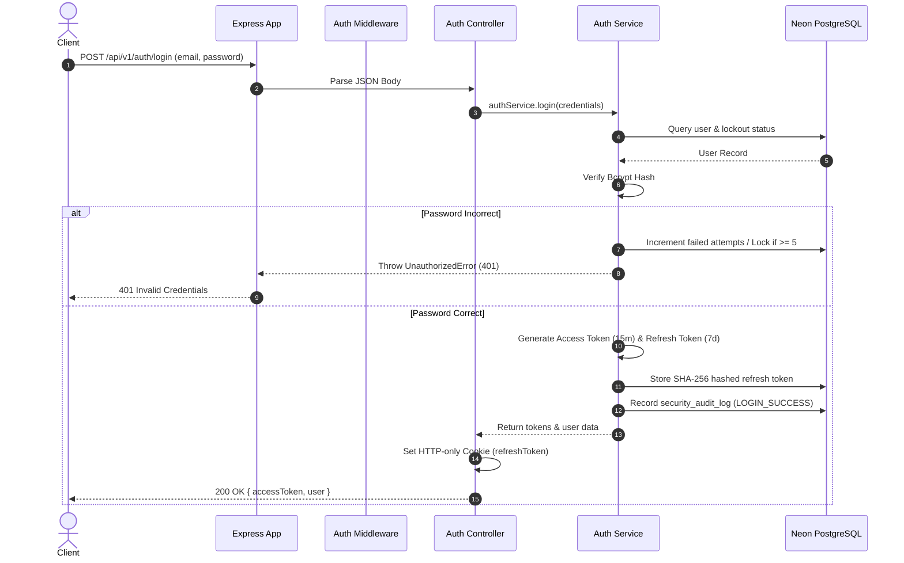

# 🏛️ Backend Architecture & Folder Structure Specification

> **Project**: Game Account Marketplace Platform (Hybrid B2C & C2C)  
> **Tech Stack**: Node.js, Express, TypeScript, Prisma ORM, Neon Serverless PostgreSQL, Redis, Socket.io  
> **Design Pattern**: Feature-First Modular Clean Architecture / Domain-Driven Design (DDD)

---

## 📌 1. Architectural Philosophy

Our backend adopts a **Feature-First (Domain-Driven) Modular Architecture**. Unlike the traditional "Layer-First" design (which piles all controllers into one folder, all services into another, and all models into another), our architecture groups files by **business domain / feature capability**.

### Core Principles
1. **High Cohesion, Low Coupling**: Every business module (`auth`, `accounts`, `orders`, `wallet`, etc.) is self-contained.
2. **Separation of Concerns (SoC)**:
   - **Controllers**: Handle HTTP transports, status codes, cookies, and serialization.
   - **Services**: Pure business logic, financial calculations, state transitions, and database transactions.
   - **Middlewares**: Guarding, validation, error interception, and access control.
   - **Prisma Schema**: Strongly typed database entities and constraints.
3. **Enterprise Defense-in-Depth**:
   - Zero-Knowledge AES-256-GCM encryption for stored gaming account credentials.
   - Dual-token JWT rotation via secure HTTP-only cookies to eliminate XSS/CSRF vectors.
   - Automated account lockout and security audit trail.
4. **Scalability Ready**: Multiple engineers can work on different business modules simultaneously without merge conflicts.

---

## 🌳 2. Complete Visual Directory Tree

```text
Plateform Sell Account Game/
├── 📁 .git/                                 # Git version control repository
├── 📄 .gitignore                            # Root ignore file (protects .env, node_modules)
├── 📄 README.md                             # High-level project overview & quickstart
├── 📄 ARCHITECTURE_STRUCTURE.md             # Complete architectural documentation (This file)
├── 📄 animetion_plateform.md                # UI & Animation specifications
├── 📄 pdf_extract.txt                       # Business specification raw text
│
├── 📁 Concept Plateform/                    # Business design & roadmap documents
│   ├── Backend Development Flow & Architecture Roadmap-Game Account Marketplace.pdf
│   ├── Database Design & System Flow-Game Account Marketplace.pdf
│   └── Full UX_UI & Motion Design Specification.pdf
│
├── 📁 ERD Diagram & Database/               # Database visual designs & SQL schema
│   ├── Plateform Sell Account Game.png      # Visual ERD diagram
│   ├── Plateform Sell Account Game.pdf      # Detailed ERD document
│   └── Plateform Sell Account Game.sql      # Raw PostgreSQL DDL schema
│
├── 📁 UXUI/                                 # Complete 11-page UX/UI design assets & mockups
│
└── 📁 backend/                              # Production Express + TypeScript Backend
    ├── 📄 package.json                      # Dependencies and lifecycle scripts
    ├── 📄 tsconfig.json                     # Strict TypeScript compiler configuration
    ├── 📄 prisma.config.ts                  # Prisma 7 configuration file
    ├── 📄 .env                              # Local environment secrets (NEVER committed)
    ├── 📄 .env.example                      # Environment variables template
    ├── 📄 .gitignore                        # Backend-specific ignore rules
    │
    ├── 📁 prisma/                           # Database Schema & Migrations
    │   ├── schema.prisma                    # 25 strongly typed relational models
    │   └── seed.ts                          # Initial data seeding (Games, Admin, Coupons)
    │
    └── 📁 src/                              # TypeScript Source Code
        ├── 📄 server.ts                     # HTTP + Socket.io Server Entry & Graceful Shutdown
        ├── 📄 app.ts                        # Express Application Factory (Middlewares, Security)
        │
        ├── 📁 config/                       # Centralized Configurations
        │   ├── index.ts                     # Strict environment variable validation
        │   └── database.ts                  # Prisma Client Singleton with PG Connection Pool
        │
        ├── 📁 common/                       # Shared Cross-Cutting Infrastructure
        │   ├── 📁 errors/                   # Custom typed application error hierarchy
        │   │   ├── AppError.ts              # Base AppError, BadRequest, Unauthorized, etc.
        │   │   └── index.ts                 # Clean barrel export
        │   ├── 📁 middleware/               # Global interceptors & security guards
        │   │   ├── auth.ts                  # JWT verify & RBAC role authorization
        │   │   ├── errorHandler.ts          # Centralized error handler & JSON formatter
        │   │   ├── notFoundHandler.ts       # 404 Route interceptor
        │   │   └── validate.ts              # express-validator result handler
        │   ├── 📁 utils/                    # Reusable helper libraries
        │   │   ├── crypto.ts                # AES-256-GCM vault & SHA-256 hashing
        │   │   ├── jwt.ts                   # Token signing & verification
        │   │   ├── json.ts                  # BigInt to JSON serialization patch
        │   │   └── response.ts              # Standardized API response formatters
        │   ├── 📁 types/                    # Ambient & Global TypeScript definitions
        │   │   └── index.ts                 # Express Request.user namespace augmentation
        │   └── 📁 validators/               # Reusable validation helpers
        │
        └── 📁 modules/                      # 🚀 Feature-First Business Modules
            ├── 📁 auth/                     # Authentication & Security Module (Phase 2)
            │   ├── controllers/             # auth.controller.ts (HTTP endpoints)
            │   ├── services/                # auth.service.ts (Business logic & DB ops)
            │   ├── routes/                  # auth.routes.ts (Route declarations)
            │   ├── validators/              # auth.validator.ts (express-validator rules)
            │   └── dto/                     # Data Transfer Objects
            │
            ├── 📁 accounts/                 # Game Catalog & Listings Module (Phase 4)
            │   ├── controllers/             # Listing creation, catalog browsing
            │   ├── services/                # Account encryption vault & search filters
            │   ├── routes/                  # /api/v1/accounts, /api/v1/games
            │   └── validators/              # Listing payload verification
            │
            ├── 📁 orders/                   # Escrow Orders & Concurrency Lock (Phase 5)
            │   ├── controllers/             # Checkout, order details, release funds
            │   ├── services/                # 15-min reservation lock, order state machine
            │   ├── routes/                  # /api/v1/orders
            │   └── validators/              # Order inputs
            │
            ├── 📁 payments/                 # Payments & KHQR Gateway (Phase 6)
            │   ├── controllers/             # KHQR generation, Webhook handlers
            │   ├── services/                # Bakong KHQR verification, coupon engine
            │   └── routes/                  # /api/v1/payments
            │
            ├── 📁 wallet/                   # Financial Ledger & Payouts (Phase 7)
            │   ├── controllers/             # Wallet balance, withdrawal requests
            │   ├── services/                # Double-entry ledger, 10% platform fee
            │   └── routes/                  # /api/v1/wallet
            │
            └── 📁 chat/                     # Real-Time Escrow Chat & Disputes (Phase 8)
                ├── controllers/             # Chat history, dispute filing
                ├── services/                # Message storage, dispute arbitration
                └── routes/                  # /api/v1/chat, /api/v1/disputes
```

---

## 🧩 3. Architectural Layers Explained

### Layer 1: Entry Point & Application Bootstrap
- **`src/server.ts`**:
  - Initializes the HTTP server and attaches the **Socket.io** WebSocket instance.
  - Registers order rooms (`order:<id>`) for real-time buyer-seller escrow communication.
  - Implements **Graceful Shutdown** (`SIGINT`, `SIGTERM`) to cleanly disconnect PostgreSQL connection pools and finish in-flight requests without data corruption.
- **`src/app.ts`**:
  - Configures security headers with **Helmet** (preventing clickjacking, MIME-sniffing).
  - Configures **CORS** with strict origins and credential allowances.
  - Registers **Morgan HTTP logger**, compression, cookie parsers, and JSON body limits.
  - Exposes health checks (`/health`) and version info (`/api/v1`).

---

### Layer 2: Persistence & Cloud Database Layer
- **Neon Serverless PostgreSQL (AWS Singapore ap-southeast-1)**:
  - High availability, automated branching, and autoscaling.
  - Integrated via **Prisma 7** using `@prisma/adapter-pg` and custom connection pooling.
- **`prisma/schema.prisma`**:
  - Contains **25 normalized relational tables** mapped cleanly using snake_case DB table names (`@@map("users")`) and camelCase TypeScript properties.
  - Enforces Foreign Key constraints, cascading deletes, unique composite indexes, and decimal precision for financial amounts.
- **`prisma/seed.ts`**:
  - Injects foundational platform seeds: 6 primary games, platform admin account, and welcome coupons.

---

### Layer 3: Common Cross-Cutting Infrastructure (`src/common/`)
- **`errors/AppError.ts`**:
  - Standardized error hierarchy extending `Error`:
    - `BadRequestError` (400)
    - `UnauthorizedError` (401)
    - `ForbiddenError` (403)
    - `NotFoundError` (404)
    - `ConflictError` (409)
    - `ValidationError` (422)
    - `TooManyRequestsError` (429)
- **`middleware/errorHandler.ts`**:
  - Global error trap preventing application crashes. In development mode, it provides detailed stack traces; in production, it safely sanitizes internal database errors.
- **`utils/crypto.ts`**:
  - **AES-256-GCM Encryption**: Used for storing game account login credentials with initialization vectors (IV) and authentication tags to guarantee data integrity.
  - **Token Hashing**: Secure SHA-256 hashing for refresh tokens and single-use password reset tokens.
  - **Referral Code Generation**: Unique cryptographically randomized referral codes.
- **`utils/json.ts`**:
  - Implements monkey-patching for `BigInt.prototype.toJSON` ensuring seamless `res.json()` serialization of BigInt primary and foreign keys without runtime type exceptions.
- **`utils/response.ts`**:
  - Uniform API response envelopes:
    ```json
    {
      "success": true,
      "message": "Resource created successfully",
      "data": { ... },
      "meta": { "page": 1, "limit": 20, "total": 100 }
    }
    ```

---

### Layer 4: Feature-First Domain Modules (`src/modules/`)
Each domain module operates as an independent bounded context with a 4-tier pipeline:

```text
[ Client HTTP Request ]
          │
          ▼
┌───────────────────┐
│   Routes Layer    │  ──> Defines endpoints, HTTP verbs, and middleware chains
└───────────────────┘
          │
          ▼
┌───────────────────┐
│ Validation Layer  │  ──> express-validator schemas validate and sanitize inputs
└───────────────────┘
          │
          ▼
┌───────────────────┐
│ Controller Layer  │  ──> Extracts params/body, sets cookies, invokes service
└───────────────────┘
          │
          ▼
┌───────────────────┐
│   Service Layer   │  ──> Business rules, transactions, encryption, database access
└───────────────────┘
          │
          ▼
┌───────────────────┐
│  Neon PostgreSQL  │  ──> Data persistence via Prisma ORM
└───────────────────┘
```

#### Detailed Module Responsibilities:
1. **`auth/` (Authentication & Security)**:
   - Registration with automatic wallet and notification creation.
   - Login with bcrypt password verification and brute-force lockout after 5 attempts.
   - Dual-token JWT architecture (15m Access Token + 7d Refresh Token Rotation in HTTP-only cookies).
   - Single-use 1-hour password reset token flow.
   - Security audit logging (`security_audit_logs`).
2. **`accounts/` (Catalog & Credential Vault)**:
   - Game account listings (B2C platform-owned and C2C peer-to-peer).
   - Multi-platform binding status (Moonton, Google, Facebook, etc.).
   - Multi-image screenshot uploads with primary preview selector.
   - Zero-Knowledge encrypted credentials vault (AES-256-GCM).
3. **`orders/` (Escrow State Machine)**:
   - 15-minute reservation timer via distributed concurrency locks.
   - Snapshot preservation of account attributes at checkout time.
   - State Machine: `pending` ➔ `paid` ➔ `in_escrow` ➔ `completed` / `disputed` / `refunded`.
4. **`payments/` (Bakong KHQR & Webhook)**:
   - Dynamic KHQR code generation.
   - Webhook idempotency and HMAC verification.
   - Coupon discount calculation.
5. **`wallet/` (Ledger & Commission Engine)**:
   - Double-entry accounting ledger.
   - 10% platform commission deduction.
   - Seller withdrawal requests and banking destination verification.
   - Referral reward distributions.
6. **`chat/` (Real-Time Escrow & Disputes)**:
   - Secure private WebSocket rooms between buyer and seller during escrow.
   - Dispute management and administrative arbitration overrides.

---

## 🔒 4. Security Flow Overview



---

## 🛠️ 5. Development Guidelines (Adding New Features)

When adding a new feature (e.g. `reviews`), follow this standardized protocol:

1. **Database Schema**: Add the model to [`prisma/schema.prisma`](file:///d:/Plateform%20Sell%20Account%20Game/backend/prisma/schema.prisma) and run `npm run db:push`.
2. **Module Directory**: Create `src/modules/reviews/` with:
   - `controllers/reviews.controller.ts`
   - `services/reviews.service.ts`
   - `routes/reviews.routes.ts`
   - `validators/reviews.validator.ts`
3. **Route Mounting**: Import and mount the router in [`src/app.ts`](file:///d:/Plateform%20Sell%20Account%20Game/backend/src/app.ts):
   ```typescript
   app.use(`${config.apiPrefix}/reviews`, reviewsRoutes);
   ```
4. **Error Handling**: Use existing custom errors from [`src/common/errors`](file:///d:/Plateform%20Sell%20Account%20Game/backend/src/common/errors) (`BadRequestError`, `NotFoundError`, etc.).
5. **Response Formatting**: Always use `sendSuccess` or `sendCreated` from [`src/common/utils/response.ts`](file:///d:/Plateform%20Sell%20Account%20Game/backend/src/common/utils/response.ts).

---

## 🏆 Summary

Our backend architecture is designed to meet **Enterprise Production Standards**:
- **Clean**: Zero spaghettified code, strict separation of concerns.
- **Secure**: Banking-grade encryption, dual-token rotation, brute-force defense, and audit trails.
- **Scalable**: Built for high concurrency with distributed lock models, serverless PostgreSQL, and WebSockets.
- **Maintainable**: Transparent modular design that is immediately clear to any software engineer.
